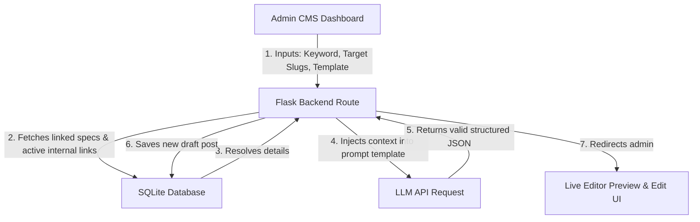

# Architectural Design: AI-CMS Auto-Generation & Publishing Workflow

This document outlines the architectural specifications to integrate Google Gemini or Anthropic Claude directly into the CMS for automated, one-click SEO-optimized article generation.

---

## 1. High-Level System Flow

---

## 2. Admin Interface Inputs (UI)
Inside the Admin panel, a dedicated page `/admin/generate-ai` will present the following fields:
* **Target Focus Keyword**: (e.g. `Sony WH-1000XM5 Test`)
* **LSI / Secondary Keywords (Optional)**: (Text input for semantic clusters, e.g. `Noise Cancelling, Akkulaufzeit, LDAC Support, App-Steuerung` to guide the LLM's entity mapping)
* **Template Selector**: (Dropdown: `product_review_template`, `best_x_for_y_template`, `affiliate_comparison_template`, `standard`)
* **Core Product Slug(s)**: (Multi-select dropdown populated dynamically from the `AffiliateLink` table database inventory)
* **Status**: (Draft or Published toggle)
* **Raw Copy-Paste Source Info**: (Textarea for pasting manual specs, review transcripts, or product URLs to scrape)

---

## 3. Backend Merging Logic (The Context Engine)

Before making the LLM request, the Flask backend runs three critical queries to build the context and prevent AI hallucinations or dead/hallucinated links:

### A. Raw Product Details Resolution
The backend queries the `AffiliateLink` table for the selected product slugs. It pulls:
* Name & Title
* Real-time Sync Price
* Current specs list (`features_json`)
* Image URL

This is injected into the LLM prompt: *"Here is the official product metadata to use: [Title: ..., Price: ..., Specs: ...]. You must use these exact values."*

### B. Dynamic Alternatives Selection (Same Category Only)
To suggest valid alternatives inside reviews:
1. The backend queries the `AffiliateLink` table for other links matching the **same category** as the target product.
2. It lists these options to the LLM: *"You must select up to 2 of the following approved products to populate the alternatives section, using their exact names and affiliate slugs: [List of available links]"*.

### C. Automated Internal Linking (Topical Siloing)
To construct contextually relevant link connections that establish topical authority:
1. The backend queries the database for:
   * **Primary Silo**: The 5 most recent published posts in the **same category** (to maintain thematic siloing).
   * **Secondary / Site-wide**: The 5 most recent published posts site-wide.
2. It passes this structured array to the LLM: *"Here are active internal posts you can link to. Prioritize linking to posts in the same category (Primary Silo) before using site-wide fallback links: [Titles and URLs of matching posts]"*. This keeps internal link equity contained within relevant subject categories.

---

## 4. LLM API Call & Structured JSON Mode
The request is made using the official SDK (e.g., `google-genai` for Gemini 2.0+ or `anthropic` for Claude 3.5). 

To ensure the JSON remains uncorrupted during long generations:
1. **JSON Output Schema**: Enforce a strict Pydantic model response format on the API level.
2. **Escaping Constraints**: The system prompt instructs the AI to use ONLY single quotes for HTML attributes and escape nested double quotes (`\"`).
3. **Paragraph Breaks**: Instruct the LLM to write plain text separated by double newlines (`\n\n`) within the text strings to match the template's `whitespace-pre-line` layout properties.

---

## 5. Live Server Considerations (Production Tuning)

### A. Asynchronous Request Handling
Generating a 1500+ word review takes between 15 to 30 seconds. On a live production server, standard HTTP requests may time out or block server threads.
* **Solution**: Trigger the generation asynchronously. Use **Celery** with a **Redis** broker to handle the API generation in a worker thread.
* **Frontend UX**: The admin panel initiates a task and polls an API endpoint (or uses Server-Sent Events / SSE) to show a visual loading progress indicator.

### B. Security & Keys
All API keys (`GEMINI_API_KEY` or `ANTHROPIC_API_KEY`) are stored strictly inside the `.env` file on the live server and loaded using standard `os.getenv` calls.

### C. Live Scraper Integration (Optional Extension)
Instead of copy-pasting raw text, integrate `requests` + `BeautifulSoup` or an external scraping API to fetch the manufacturer's product landing page or Amazon product details dynamically on-demand before sending the context payload to the LLM.

---

## 6. Reviewer Point of View (POV) Questionnaire & Notes (Optional)

To enforce E-E-A-T signals (Expertise & Authoritativeness), the generator UI can dynamically render a series of **optional rating metrics and quick notes** for each target product. If provided, the backend compiles this feedback to guide the LLM's review sentiment and findings.

### A. Generic 4-Question POV Slider (QCM)
These 4 metrics apply cleanly to any product niche (from smart tech, to gardening tools, to baby products). They use a slider scoring from `0.0` (critical/poor) to `1.0` (exceptional/great):

1. **Value & Price-to-Performance (Preis-Leistung)**
   * `0.0`: Severely overpriced, poor value.
   * `0.5`: Decently priced for what it offers.
   * `1.0`: Bargain/outstanding value.
2. **Build Quality & Durability (Verarbeitung & Material)**
   * `0.0`: Cheap materials, fragile, prone to wear.
   * `0.5`: Decent, industry-standard build quality.
   * `1.0`: Premium finish, highly durable, built to last.
3. **Usability & Setup (Handhabung & Installation)**
   * `0.0`: Frustrating to set up, high learning curve.
   * `0.5`: Normal learning curve, standard instructions.
   * `1.0`: Plug-and-play, effortless, extremely intuitive.
4. **Expectation Match & Practical Utility (Alltagstauglichkeit)**
   * `0.0`: Disappointing, fails to solve the main problem.
   * `0.5`: Satisfies basic functions as advertised.
   * `1.0`: Game-changer, exceeds expectations, indispensable.

### B. Free-Form Quick Notes Box
A simple input box allowing the reviewer to type a quick outline (e.g., *"great suction power, but charging base is bulky, packaging was slightly torn, feels premium but a bit heavy"*).

### C. Multi-Product Handling (Listicle & Comparisons)
* **Single Review**: The page displays one set of sliders and notes.
* **Listicles & Comparison**: The UI renders these fields as collapsible panels **under each selected product** in the list. The admin can fill them out for all products, only a few, or leave them completely empty (in which case the LLM relies entirely on scraped/pasted specifications).

### D. Prompt Generation Translation
The backend translates these inputs into explicit LLM guidance guidelines:
* **Sentiment Steering**: Sliders determine how critical or positive the LLM reviews each aspect. For example, a `0.2` on Value forces the LLM to write a critical verdict highlighting that the item is overpriced.
* **Review Specificity**: The quick notes are passed directly to the LLM system prompt:
  > *"CRITICAL: Integrate the reviewer's hands-on observations directly into the review sections and pros/cons list. Use first-person perspective signals such as 'In unserem Test fiel uns besonders auf...' (In our test, we particularly noticed...) or 'Unsere Praxiserfahrung zeigt...' to emphasize original observation over generic manufacturer specs. Specifically mention that: [Notes text]. Maintain an authentic, expert tone."*

---

## 7. Technical & SEO Audit Refinements

To ensure production reliability and maximum search engine performance, keep the following rules in mind:

### A. Output Token Truncation Mitigation
* **Risk**: Generating +1500 words of German text in a single JSON payload risks exceeding LLM output token limits (causing truncated/broken JSON).
* **Fix**: Force-configure the API call parameter `max_tokens` (e.g., to `8192` for Gemini 1.5 Pro or Claude 3.5 Sonnet). If utilizing smaller models, split the generation into two sequential steps:
  1. *Step 1*: Generate the JSON metadata, FAQs, table structures, and Verdict.
  2. *Step 2*: Generate the long-form markdown text sections using the Step 1 context.

### B. Anchor Text Optimization for Internal Links
* **Risk**: LLMs default to generic anchor phrases like *"Klicken Sie [hier](/blog/link)"* which harms crawl value.
* **Fix**: Append a strict system rule to the context processor:
  > *"Rule: When inserting internal links, always use descriptive, keyword-rich anchor text that describes the target page. Never use generic phrases like 'hier klicken', 'Link', or 'dieser Beitrag'."*

### C. Brand Tone Alignment
* **Risk**: The AI might write in a formal tone (*"Sie"*), whereas the blog style might use *"Du"* or *"Wir"*.
* **Fix**: Declare the tone in `config.yaml` (e.g., `seo: tone: "Du"` or `tone: "Wir-Editorial"`) and dynamically inject it into the LLM system prompt instructions.

### D. Featured "Snippet-Bait" Structure
* **Risk**: Google pulls punchy summaries and FAQs into Featured Snippets (Position Zero). Wordy or vague AI output will lose these rankings.
* **Fix**: Enforce strict syntax formatting rules:
  * **Verdict Summary**: The very first sentence of the verdict block must be a concise, definitive summary under 45 words starting with `"[Product Name] ist..."`.
  * **FAQ Answers**: FAQ answers must begin with a direct *"Ja,"* or *"Nein,"* (Yes/No) followed immediately by a single-sentence explanation, before expanding into detail.

### E. Image Alt-Text & Metadata Field
* **Risk**: Missing descriptive image alt-text harms Image Search performance and fails accessibility audits.
* **Fix**: Include an explicit `"image_alt_text"` string field in the JSON schema returned by the LLM. Instruct the AI to write a keyword-optimized, descriptive summary of the product image.

### F. Specification Invariant Enforcement
* **Risk**: Discrepancies between the data comparison tables and the text bodies (e.g., listing a battery as 30h in text but 20h in the table) damage user trust and SEO bounce rates.
* **Fix**: Instruct the LLM that all specs, scores, and columns in comparison tables must derive directly from the `features_json` and specs context provided by the database. Generating fictional or contradictory metrics is strictly prohibited.

### G. German Decimal Protocol (Schema vs. UI)
* **Risk**: Storing German-formatted prices (e.g. `299,99 €`) breaks Google Search Console JSON-LD validations, while storing pure decimals (e.g. `299.99`) looks unnatural to German site visitors.
* **Fix**: Force the LLM to return two distinct price fields:
  * `price_raw` / `price`: A clean decimal string (e.g., `299.99`) with a period separator for the JSON-LD schema.
  * `price_display`: A formatted string (e.g., `299,99 €` or `ab 299,00 €`) for user interface rendering.

### H. Entity Density (NLP Optimization)
* **Risk**: The AI uses general vocabulary instead of specialized terminology, lowering semantic topical relevance.
* **Fix**: Instruct the LLM to locate core technical specs and entities from the product context (e.g., `LDAC`, `USB 3.2 Gen 2`, `PCIe 5.0`, `IP68`) and include each core entity term at least twice naturally inside the body text.

### I. First-Person Experience Triggers
* **Risk**: The generated copy reads like a passive product brochure rather than an authentic hands-on test.
* **Fix**: Add a strict rule: If a POV slider or notes input is provided, the LLM must weave in at least three active first-person test phrases, such as:
  * *"In unserem Praxistest zeigte sich..."*
  * *"Besonders positiv ist uns aufgefallen..."*
  * *"Nach mehrstündiger Nutzung können wir sagen..."*

### J. Heading Neutralization (AI Detection Prevention)
* **Risk**: Using words like *"Conclusion"* or *"Schlussfolgerung"* is a strong footprint indicator for automated AI writing.
* **Fix**: Explicitly instruct the LLM to avoid generic conclusion headings. Force it to use natural, highly-targeted German equivalents like *"Fazit"* or *"Unser Testurteil"* (Our Verdict).

### K. Markdown-First JSON Integrity
* **Risk**: LLMs nesting complex HTML markup tags inside JSON values regularly trigger parsing crashes due to unescaped double quotes.
* **Fix**: Force the LLM to use strictly standard Markdown (e.g. `###`, `**`, `[Link](url)`) within sections, summaries, and description text values. The templates render these fields using Flask's dynamic `| markdown` filter, ensuring 100% JSON parsing stability.

### L. Mobile-First Table Constraint
* **Risk**: Overcrowded specification tables containing 10+ columns break mobile responsiveness and fail Google's mobile usability crawls.
* **Fix**: Instruct the LLM to select only the top 5-6 most critical product specification dimensions (e.g., *Schnittstelle, Kapazität, Lesegeschwindigkeit, Garantie, Preis*) for comparison table columns based on high-intent buyer interest.

### M. "People Also Ask" (PAA) Long-Tail FAQ Logic
* **Risk**: Standard FAQs are generic and fail to target actual long-tail search questions.
* **Fix**: Force the LLM FAQ generation block to follow structural rules:
  * At least one question must cover *how-to* or *compatibility* (e.g. *"Wie installiere ich..."* or *"Ist X kompatibel mit..."*).
  * At least one question must cover *purchase value/upgrade comparison* (e.g. *"Lohnt sich der Aufpreis für..."*).

### N. Internal Link "Safety Fallback"
* **Risk**: Forcing internal links into contextually irrelevant body paragraphs degrades editorial quality and increases reader bounce rates.
* **Fix**: Instruct the LLM that if a natural, logical semantic context for a target internal link is not found inside the article bodies, it must place the link under a bulleted *"Verwandte Artikel"* (Related Articles) list at the very end of the final section.

